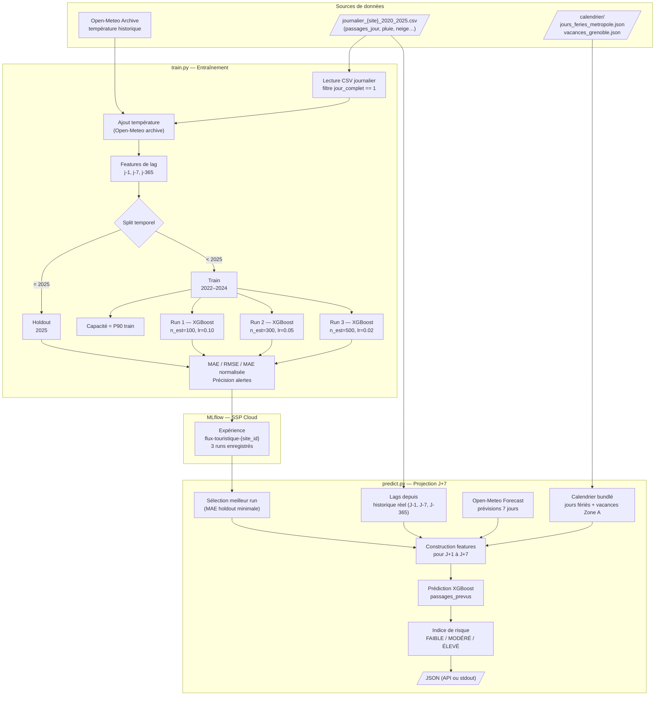

# Pipeline ML — Anticipation de fréquentation touristique

**Hackathon DGE — Gestion des flux touristiques | Équipe 2 | 9–10 novembre 2026**

---

## Vue d'ensemble

Le pipeline prédit la fréquentation journalière d'un site touristique à horizon J+7 et dérive un **indice de risque de sur-fréquentation** (faible / modéré / élevé) permettant aux gestionnaires de passer d'une gestion réactive à proactive.

Le pipeline couvre **7 sites ENS (CG38 Environnement)** avec des données journalières pré-agrégées 2020–2025, un expérience MLflow par site.

```
CSV journalier pré-agrégé (2020–2025)  ─┐
Météo historique (Open-Meteo Archive)  ─┼─► train.py ─► 3 modèles XGBoost tracés dans MLflow
Calendrier bundlé (JSON local)         ─┘

Meilleur modèle MLflow ─┐
Météo prévisionnelle    ├─► predict.py ─► Indice de risque J+7 (JSON)
Calendrier bundlé      ─┘
```

### Flowchart détaillé



---

## Données d'entrée

### Sites couverts

| Site ID | Nom | Commune | Jours complets |
|---|---|---|---|
| `herretang` | Herretang — Tuilerie | Saint-Joseph-de-Rivière | 2 055 |
| `veronniere` | Marais de la Véronnière | Morestel | 2 166 |
| `ecouges_pont_chabert` | Écouges — Pont Chabert piéton | Cognin-les-Gorges | 2 057 |
| `etang_serre_observatoire` | Étang de la Serre — observatoire | Sermerieu | 2 186 |
| `etang_lemps_sentier` | Étang de Lemps — sentier | Bouvesse-Quirieu | 2 186 |
| `etang_lemps_observatoire` | Étang de Lemps — observatoire | Bouvesse-Quirieu | 2 186 |
| `lac_save_ouest` | Lac de Save — ouest | Optevoz | 2 135 |

Les CSV journaliers pré-agrégés sont fournis par CG38 Environnement (`journalier_{site}_2020_2025.csv`). Chaque ligne correspond à un jour ; le filtre `jour_complet == 1` élimine les jours incomplets.

### Météo — Open-Meteo

- **Historique** : API `archive-api.open-meteo.com/v1/archive`
  - Variable : `temperature_2m_mean` (journalière)
  - Jointure sur la colonne `date` du CSV journalier
- **Prévisionnel** : API `api.open-meteo.com/v1/forecast`
  - Variables : `temperature_2m_mean`, `precipitation_sum`, `precipitation_hours`, `snowfall_sum`
  - Horizon : 7 jours

### Calendrier — fichiers JSON bundlés

| Fichier | Contenu |
|---|---|
| `data/calendrier/jours_feries_metropole.json` | 285 jours fériés métropolitains (dict `{"YYYY-MM-DD": "label"}`) |
| `data/calendrier/vacances_grenoble.json` | 64 périodes de vacances scolaires Zone A / académie Grenoble |

Aucun appel API à l'entraînement ni à la prédiction pour le calendrier.

---

## Étape 1 — Entraînement (`train.py`)

### Préprocessing

```
CSV journalier pré-agrégé
      │
      ▼
Filtre jour_complet == 1
      │
      ▼
Ajout température journalière (API Open-Meteo historique)
      │
      ▼
Features de lag
  passages_j1   = passages_jour décalé de 1 jour
  passages_j7   = passages_jour décalé de 7 jours
  passages_j365 = passages_jour même date l'an passé (merge par date)
      │
      ▼
Suppression des lignes sans lag complet
```

### Split temporel

| Jeu | Période | Usage |
|---|---|---|
| Train | **2022–2024** | Entraînement du modèle (~1 095 jours) |
| Holdout | 2025 | Évaluation hors-échantillon (~365 jours) |

> **Pourquoi exclure 2020–2021 ?** Les années COVID (confinements, couvre-feux, réouvertures par décret) produisent des schémas de fréquentation sans équivalent en régime normal. Les inclure dans le train biaisait la baseline apprise par le modèle. Les données 2020–2021 restent chargées en mémoire pour alimenter le lag J-365 des premières lignes de 2022.

### Features (12 variables)

| Feature | Type | Source |
|---|---|---|
| `mois` | calendaire | date |
| `jour_semaine` | calendaire | date (0 = lundi) |
| `weekend` | calendaire | date |
| `jour_ferie` | calendaire | JSON bundlé |
| `vacances_scolaires_zone_a` | calendaire | JSON bundlé |
| `temperature_moy` | météo | Open-Meteo historique |
| `precipitations_mm` | météo | CSV journalier |
| `pluie_heures` | météo | CSV journalier |
| `neige_oui_non_jour` | météo | CSV journalier |
| `passages_j1` | lag | passages J-1 |
| `passages_j7` | lag | passages J-7 (même jour de semaine) |
| `passages_j365` | lag | passages même date l'année précédente |

### Transformation de la cible

La cible `passages_jour` est transformée en **log1p** (`ln(y + 1)`) avant l'entraînement XGBoost, et les prédictions sont inversées en **expm1** à la sortie. Cette transformation réduit le poids des pics extrêmes dans la loss XGBoost (journées à 400+ passages sur des sites avec une médiane à 24) sans modifier l'interface externe — les métriques et les prédictions restent exprimées en passages/jour.

Contrôlé par `LOG_TRANSFORM = True` dans `config.py`.

### Capacité de charge

- **Si définie** dans `sites.py` : valeur fixée avec le gestionnaire du site.
- **Sinon** : estimée automatiquement au **percentile 90** du jeu d'entraînement ("jour chargé mais pas exceptionnel").

### Hyperparamètres explorés (3 runs)

| Run | n_estimators | max_depth | learning_rate | subsample |
|-----|-------------|-----------|---------------|-----------|
| xgb-run-1 | 100 | 3 | 0.10 | 1.0 |
| xgb-run-2 | 300 | 5 | 0.05 | 0.8 |
| xgb-run-3 | 500 | 6 | 0.02 | 0.8 |

Tous les runs utilisent `random_state=42`. Les prédictions sont clampées à 0 (`np.clip(..., 0, None)`).

### Métriques

| Métrique | Description |
|---|---|
| `mae_holdout` | Erreur absolue moyenne (passages/jour) — **critère de sélection du meilleur modèle** |
| `rmse_holdout` | Racine de l'erreur quadratique moyenne |
| `mae_normalisee_holdout` | MAE / médiane du holdout × 100 — comparable entre sites de volumes très différents |
| `precision_alerte_elevee` | % des jours où le niveau d'alerte élevé est correctement prédit |

### Suivi MLflow

- **Experiment** : `flux-touristique-{site_id}` (une expérience par site)
- **URI** : configurable via `MLFLOW_TRACKING_URI` (défaut : instance SSP Cloud)
- **Artefacts loggués** : paramètres, métriques, `feature_importance.json`, modèle XGBoost

---

## Étape 2 — Projection J+7 (`predict.py`)

### Chargement du modèle

Le script sélectionne parmi les **3 runs les plus récents** de l'expérience MLflow celui qui minimise `mae_holdout`. Les runs plus anciens ne sont pas considérés.

### Construction des features pour les 7 prochains jours

```
Pour chaque jour J dans [aujourd'hui, aujourd'hui+6] :

  Météo         ← Open-Meteo forecast (temperature, precipitation, pluie_heures, neige)
  Calendrier    ← JSON bundlés (jours fériés + vacances scolaires)
  passages_j1   ← historique réel si disponible, sinon médiane de l'historique
  passages_j7   ← idem (fallback médiane si données > 30 jours anciennes)
```

### Calcul de l'indice de risque

```
taux_charge = passages_prévus / capacité_journalière

ÉLEVÉ   si taux_charge ≥ 85 %
MODÉRÉ  si taux_charge ≥ 60 %
FAIBLE  sinon
```

### Sorties

**API** (`GET /predict/{site_id}`) : JSON structuré avec prédictions, niveaux de risque et météo par jour.
**CLI** (`python predict.py --site herretang`) : JSON sur stdout.

---

## Configuration (`config.py` + `sites.py`)

**`config.py`** — paramètres transversaux :
```python
MLFLOW = {
    "uri":         "...",   # via MLFLOW_TRACKING_URI
    "metric_best": "mae_holdout",
}

FEATURES = [
    "mois", "jour_semaine", "weekend", "jour_ferie", "vacances_scolaires_zone_a",
    "temperature_moy", "precipitations_mm", "pluie_heures", "neige_oui_non_jour",
    "passages_j1", "passages_j7",
]

DATA_DIR       = Path(...)                   # via DATA_DIR env var
CALENDRIER_DIR = DATA_DIR / "calendrier"
```

**`sites.py`** — catalogue des 7 sites, un dict par entrée :
```python
SITES = {
    "herretang": {
        "nom": "Herretang — Tuilerie",
        "latitude": 45.38224, "longitude": 5.68871,
        "capacite_journaliere": None,         # None → P90 auto
        "seuils_risque": {"modere": 0.60, "eleve": 0.85},
        "mlflow_experiment": "flux-touristique-herretang",
        "journalier_csv": "herretang_2020_2025/journalier_herretang_2020_2025.csv",
    },
    # ... 6 autres sites
}
```

---

## Étape 3 — Validation hors-échantillon : backtest sur données 2026 (`poc_backtest.py`)

### Pourquoi un backtest ?

Le holdout 2025 utilisé dans `train.py` a deux rôles : évaluer les modèles **et** choisir le meilleur run. Il n'est donc pas un test strictement indépendant — le modèle sélectionné est celui qui performe le mieux sur cette même période.

Le backtest répond à une question différente : **le modèle généralise-t-il à des données qu'il n'a jamais croisées, ni pendant l'entraînement ni pendant la sélection ?**

### Stratégie de découpe temporelle

| Jeu | Période | Rôle |
|---|---|---|
| Train | 2020–2024 | Entraînement XGBoost |
| Holdout | 2025 | Sélection du meilleur modèle (MAE) |
| **Backtest** | **2026** | **Validation finale hors-échantillon** |

### Lancer le backtest

```bash
# Période par défaut (15–21 avril 2026)
python3 poc_backtest.py

# Période personnalisée
python3 poc_backtest.py --date 2026-05-04 --jours 7
```

---

## Lancer le pipeline

```bash
# 1. Entraîner le modèle pour un site
MLFLOW_TRACKING_URI=http://<host>:<port> python3 src/api/train.py --site herretang

# 2. Projeter à J+7 (CLI)
python3 src/api/predict.py --site herretang

# 3. API (après docker compose up)
curl http://localhost:8000/predict/herretang
```

---

## Limites connues et pistes d'évolution

| Limite | Impact | Évolution envisagée |
|---|---|---|
| Lag J-1 et J-7 non disponibles en temps réel | Fallback médiane imprécis | Recalage journalier automatique sur compteurs |
| Capacité de charge non formalisée pour la plupart des sites | Seuil d'alerte arbitraire | Calibrage par type de site avec gestionnaires |
| `weekend` redondant avec `jour_semaine` | Feature inutile | Supprimer ou remplacer par une interaction |
| Météo prévisionnelle dégradée au-delà de J+5 | Incertitude croissante | Afficher un intervalle de confiance |
| Pas d'événements locaux dans les features | Pics imprévus non capturés | Intégrer Apidae (6 052 événements Isère) |
